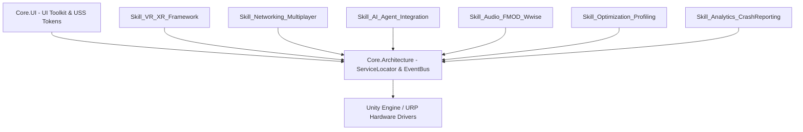

# Enterprise Base Master Unity URP Template (Top 0.01% MNC Spec)

[](LICENSE)
[](https://unity.com)
[]()
[%20%7C%20WebGL-orange.svg)]()

A production-grade, enterprise-ready base template for Unity Universal Render Pipeline (URP) projects. Engineered for maximum runtime performance, zero garbage collection allocations in update loops, full assembly isolation, and plug-and-play modularity.

---

## 📑 Table of Contents
- [Architecture Overview](#-architecture-overview)
- [Directory Layout](#-directory-layout)
- [Core Architecture Guide](#-core-architecture-guide)
  - [Service Locator](#1-service-locator)
  - [Type-Safe Event Bus (Zero-GC)](#2-type-safe-event-bus-zero-gc)
  - [Deterministic State Machine](#3-deterministic-state-machine)
- [Modular "Opt-Out" Feature Modules (Skills)](#-modular-opt-out-feature-modules-skills)
  - [VR / XR Framework](#1-skill_vr_xr_framework)
  - [Networking & Multiplayer](#2-skill_networking_multiplayer)
  - [AI Agent Integration](#3-skill_ai_agent_integration)
  - [Spatial Audio (FMOD / Wwise Abstraction)](#4-skill_audio_fmod_wwise)
  - [Optimization & Profiling](#5-skill_optimization_profiling)
  - [Analytics & Crash Reporting](#6-skill_analytics_crashreporting)
- [UI Toolkit & Stitch Pipeline](#-ui-toolkit--stitch-pipeline)
- [CI/CD Automation (GameCI)](#-cicd-automation-gameci)
- [Engineering Standards & Rules](#-engineering-standards--rules)

---

## 🏛 Architecture Overview

This project is built around **strict assembly decoupling** and **contract-first programming**:
- **Zero code in global assembly (`Assembly-CSharp.dll`)**: Every module and feature has its own independent `.asmdef`.
- **Zero heap allocations in hot paths**: `GC.Alloc` budget is strictly 0 bytes/frame across update loops. All inter-system events use `readonly struct` payloads.
- **Opt-Out Modularity**: Any module under `Assets/Core/Skills/` can be completely deleted from the project disk without breaking compilation of any other module.



---

## 📂 Directory Layout

```
[ProjectRoot]
├── .antigravity/
│   └── rules.md                  # Strict C# architectural constraints & coding rules
├── .antigravityignore             # Optimized token ignore file excluding heavy caches & binaries
├── .archify/
│   ├── system_architecture.json  # Archify system specification
│   └── dataflow.json             # Hardware to Render Graph deterministic data pipeline
├── .github/
│   └── workflows/
│       ├── 01-validation.yml     # PR Gatekeeper: Roslyn static analysis & Unity Test Runner
│       ├── 02-build-matrix.yml   # Multi-platform builds (Win64, Quest Android, WebGL)
│       └── 03-deployment.yml     # Automated artifact packaging & GitHub release publication
└── Assets/
    ├── Core/
    │   ├── Architecture/         # Core.Architecture.asmdef (Service Locator, Event Bus, FSM)
    │   ├── UI/                   # Core.UI.asmdef & Core.UI.Editor.asmdef
    │   │   ├── USS/              # GlobalDesignTokens.uss (Design system tokens)
    │   │   ├── UXML/             # BaseDashboard.uxml UI layouts
    │   │   ├── Views/            # BaseDashboardViewController.cs (ViewModel data binding)
    │   │   └── Editor/           # StitchImporter.cs (Figma/Stitch layout pipeline)
    │   └── Skills/               # Isolated Plug-and-Play modules (Each with its own .asmdef)
    │       ├── Skill_VR_XR_Framework/
    │       ├── Skill_Networking_Multiplayer/
    │       ├── Skill_AI_Agent_Integration/
    │       ├── Skill_Audio_FMOD_Wwise/
    │       ├── Skill_Optimization_Profiling/
    │       └── Skill_Analytics_CrashReporting/
    └── ProjectData/              # ScriptableObjects, game settings, and scene configurations
```

---

## 🛠 Core Architecture Guide

### 1. Service Locator
Thread-safe, decoupled dependency registry. Subsystems communicate through interfaces rather than concrete singletons.

```csharp
using Core.Architecture;

// Registering a service:
var audioService = gameObject.AddComponent<UnityAudioService>();
ServiceLocator.Register<IAudioService>(audioService);

// Resolving a service:
if (ServiceLocator.TryGet<IAudioService>(out var audio))
{
    audio.PlaySound("LaserSFX", transform.position);
}

// Unregistering on teardown:
ServiceLocator.Unregister<IAudioService>();
```

### 2. Type-Safe Event Bus (Zero-GC)
High-throughput messaging without heap allocations or boxing overhead.

```csharp
using Core.Architecture;

// 1. Define a zero-allocation event struct
public readonly struct PlayerScoredEvent : IGameEvent
{
    public readonly int Points;
    public PlayerScoredEvent(int points) => Points = points;
}

// 2. Subscribe to the event
void OnEnable()
{
    EventBus.Subscribe<PlayerScoredEvent>(OnPlayerScored);
}

void OnDisable()
{
    EventBus.Unsubscribe<PlayerScoredEvent>(OnPlayerScored);
}

// 3. Publish without boxing
EventBus.Publish(new PlayerScoredEvent(100));
```

### 3. Deterministic State Machine
Controls discrete application phases (Boot, Main Menu, In-Game, Pause).

```csharp
var fsm = new GameStateMachine();
fsm.RegisterState(new MainMenuState())
   .RegisterState(new GameplayState());

fsm.TransitionTo<GameplayState>();

// Update state in main loop
fsm.Tick(Time.deltaTime);
```

---

## 🧩 Modular "Opt-Out" Feature Modules (Skills)

Every skill folder under `Assets/Core/Skills/` is self-contained. To disable or remove any feature from your game, **simply delete its folder**—no compiler errors will be produced.

### 1. `Skill_VR_XR_Framework`
- **Assembly:** `Core.Skills.VR`
- **Features:**
  - `IVRTrackingService` & `VRTrackingService`: Headset and controller spatial tracking abstraction.
  - `VRFoveatedRenderingManager`: Automated dynamic foveated rendering presets and Quest render scale optimization.
  - `VRLocomotionController`: Smooth locomotion + snap rotation with character controller integration.

### 2. `Skill_Networking_Multiplayer`
- **Assembly:** `Core.Skills.Networking`
- **Features:**
  - `INetworkService`: Network topology abstraction (Netcode for GameObjects, Mirror, Photon Fusion ready).
  - `NetworkStateChangedEvent`: Zero-allocation connection status events.
  - `ILobbyService` & `LobbyManager`: Decoupled session creation, room joining, and matchmaking caching.

### 3. `Skill_AI_Agent_Integration`
- **Assembly:** `Core.Skills.AIAgent`
- **Features:**
  - `IAIAgentClient`: Streaming LLM client wrapper supporting token streaming callbacks and prompt completions.
  - `AgentToolDefinition`: JSON Schema tool calling pipeline for runtime agent actions.
  - `NPCStateMachine`: Event-driven state machine for intelligent agent and NPC logic.

### 4. `Skill_Audio_FMOD_Wwise`
- **Assembly:** `Core.Skills.Audio`
- **Features:**
  - `IAudioService`: Middleware-agnostic audio abstraction.
  - `UnityAudioService`: Default 3D spatial sound implementation.
  - `AudioSourcePool`: Dynamic spatial audio emitter pooling avoiding runtime GameObject instantiations.

### 5. `Skill_Optimization_Profiling`
- **Assembly:** `Core.Skills.Profiling`
- **Features:**
  - `RuntimePerformanceOverlay`: Zero-allocation in-game performance HUD displaying FPS, frame time (ms), and Mono heap consumption.
  - `GCAllocationWatchdog`: Automated detection and console alerting when per-frame memory allocation exceeds thresholds in development builds.

### 6. `Skill_Analytics_CrashReporting`
- **Assembly:** `Core.Skills.Analytics`
- **Features:**
  - `IAnalyticsService`: Privacy-compliant (GDPR/CCPA consent-gated) telemetry logger.
  - `AnalyticsCrashReporterService`: Intercepts unhandled Unity exceptions and formats stack traces for remote backends (Sentry, Bugsnag, Firebase).

---

## 🎨 UI Toolkit & Stitch Pipeline

### Global Design Tokens (`GlobalDesignTokens.uss`)
Standardized theme variables adhering to AAA UI design systems:
- Surface colors: `--color-bg-base`, `--color-bg-surface`, `--color-bg-elevated`
- Accents: `--color-primary`, `--color-accent` (Cyan), `--color-success`, `--color-error`
- Metrics: `--spacing-xs`, `--spacing-md`, `--spacing-xl`, `--radius-md`

### Stitch / Figma Automated Importer
Place raw layout exports in `Assets/Core/UI/StitchExports/` and run:
`Unity Menu > Tools > Stitch Pipeline > Sanitize & Import Stitch Layouts`
- Automatically strips unsupported CSS rules (e.g. `box-shadow`, unsupported web cursors).
- Injects global theme references (`GlobalDesignTokens.uss`) into imported UXML layouts.

---

## 🚀 CI/CD Automation (GameCI)

GitHub Actions workflows located in `.github/workflows/`:

| Workflow | Trigger | Description |
|---|---|---|
| **`01-validation.yml`** | PRs to `main`, `master`, `develop` | Runs .NET Roslyn analyzers, code formatting checks, and Unity Test Runner (EditMode & PlayMode) with code coverage |
| **`02-build-matrix.yml`** | Tags (`v*.*.*`) & merges to `main` | Multi-target build matrix: **Windows Standalone (64-bit)**, **Android / Meta Quest**, and **WebGL** with Library caching |
| **`03-deployment.yml`** | Release tags (`v*.*.*`) | Automatically packages builds into ZIP archives and publishes a GitHub Release |

### Required GitHub Secrets for CI
To enable GameCI builds, add these secrets to your repository settings (`Settings > Secrets and variables > Actions`):
- `UNITY_LICENSE` (Unity manual activation license file content)
- `UNITY_EMAIL` (Unity ID email)
- `UNITY_PASSWORD` (Unity ID password)

---

## 📜 Engineering Standards & Rules

Refer to [.antigravity/rules.md](file:///j:/UnityProjects/URPClientTemplate/.antigravity/rules.md) for full details:
1. **Zero-Allocation Budget:** No heap allocations during `Update()`. Cache references, use object pools, and pass structs with `in` / `readonly ref`.
2. **Strict Decoupling:** Never reference a skill assembly directly from another skill assembly. Communicate via `Core.Architecture` interfaces or `EventBus`.
3. **UniTask / Async:** Avoid Coroutines and raw `System.Threading.Tasks.Task` due to garbage collection and thread-safety constraints.
